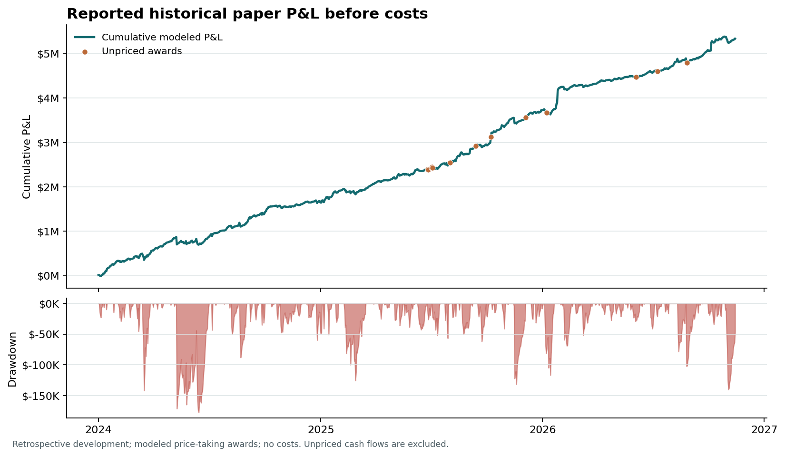

# CurrentIQ | ERCOT Point-to-Point Trading

## A capital and execution partnership for systematic congestion trading

**Investor and trading partner overview · Evidence snapshot: November 15, 2026**

CurrentIQ is seeking a capital and execution partner to evaluate and develop a systematic ERCOT point-to-point portfolio. CurrentIQ brings proprietary market research, portfolio construction and a public historical record. A partner brings qualified market access, submission capacity, credit and an agreed risk mandate.

The proposed starting point is a portfolio limited to **50 directed source-to-sink paths per day**. Over the displayed historical period, it produced **$5.34 million of modeled P&L before costs**, retained approximately **81% of the reported P&L** shown at a 100-path limit, and reported positive P&L in **32 of 34 complete calendar months**. That is a concrete reason to evaluate the smaller footprint first. It does not establish live execution or capital efficiency. [1, 2, 7]

> **Evidence basis:** Retrospective development research, January 1, 2024–November 14, 2026; modeled awards; no executed trades. Displayed quantities are twice the source-order sizes. The public cost assumption is zero, and price impact is unmodeled. Awards remain unpriced on 13 dates; their unresolved cash flows could increase or reduce the reported total. Historical input publication vintages and tradability are not fully certified. [1–3]

[Download the investor brief](currentiq-ercot-investor-brief.pdf)

*The chart includes the reported priced portion of every day, including dates that still contain unpriced awards. It is not a fully valued investment-return series or a lower bound on final P&L. Source: daily ledger; derived [chart data](assets/ercot-historical-performance-data.csv). [1]*

## Why evaluate this opportunity

**A specific portfolio within a defined market.** ERCOT point-to-point obligations create financial exposure to source–sink price differences. Day-ahead pricing and real-time settlement determine the cash result. The proposed book selects paths, hours and quantities within a stated limit on route breadth. Market access and settlement arrangements are established through a Qualified Scheduling Entity, or QSE. [2, 6]

**A substantial historical signal with a manageable review scope.** The smaller path limit retains 81.3% of the broader limit’s reported historical P&L. A desk can evaluate its own bid format, allocation and incremental exposures before considering a larger scope. Directed paths are not equivalent to bid IDs, hourly orders or required capital. [1, 7]

**Results that can be inspected beyond the headline.** Daily, weekly and monthly records, submission-credit estimates, unresolved-price fields, storm replays and a verifier are available publicly. Exact orders and proprietary inputs remain available for scoped private review. [1–5]

**A paid next step with a concrete buyer decision.** A partner-specific execution and capital assessment would establish whether the proposed portfolio fits the buyer’s submission capacity, cost structure and credit framework. The deliverable is a decision on whether a frozen forward evaluation is justified, with documented constraints and reconciliation requirements.

## Historical results at the proposed starting footprint

These results describe the 50-directed-path limit at the current displayed quantities. All dollar statistics below are **before costs** and use the reported priced P&L. The unpriced awards on 13 dates remain unresolved. [1, 2]

| Measure | Reported result |
| --- | ---: |
| Period | January 1, 2024–November 14, 2026 |
| Calendar days published | 1,049 |
| Missing result days | 0 |
| **Modeled P&L before costs** | **$5,337,290** |
| Maximum modeled drawdown | $177,139 |
| Worst day, May 9, 2024 | −$171,180 |
| Complete calendar months with positive reported P&L | 32 of 34 |
| Latest partial month, November 1–14 | +$1,825 |
| Positive reported days | 757 of 1,049 |
| P&L excluding the five best reported days | $4,539,131 |
| Drawdown at November 14 | $46,545 below the historical P&L peak |
| Dates retaining unpriced awards | 13 |

The five best reported days contribute approximately 15.0% of the total. Excluding them is a descriptive sensitivity check on the same development history. One of those dates still has unpriced awards. The two complete calendar months with negative reported P&L are May 2024 and February 2025. Completion of a calendar month does not establish complete valuation of its awards. [1]

### Calendar-period results and valuation status

| Period | Days | Modeled P&L before costs | Dates with unpriced awards |
| --- | ---: | ---: | ---: |
| 2024 | 366 | $1,651,556 | 0 |
| 2025 | 365 | $2,070,800 | 9 |
| 2026 through November 14 | 318 | $1,614,934 | 4 |

The maximum reported drawdown spans May 8–June 14, 2024. Neither that drawdown nor a submission-credit estimate supplies a defensible investment-capital denominator. No ROI, CAGR, percentage drawdown on capital or investor-return Sharpe is claimed. [1, 4]

### Why begin at the smaller path limit

The following comparison uses the same dates, zero-cost assumption and current quantity scaling. It compares limits on route breadth, without assigning proprietary names to the portfolios. [1, 7]

| Daily directed-path limit | Modeled P&L before costs | Maximum modeled drawdown | Dates with unpriced awards |
| ---: | ---: | ---: | ---: |
| **50** | **$5,337,290** | **$177,139** | **13** |
| 100 | $6,567,606 | $221,863 | 26 |

The 50-path limit retains **81.3%** of reported P&L at half the path cap. This is an observed historical comparison with incomplete valuation; it does not establish a causal benefit, half the bid-ID consumption or half the capital requirement. A desk should select the evaluation footprint from its actual submission and credit constraints.

## Execution, costs and credit

### What the published footprint does establish

| Measure | Median | 95th percentile | Maximum |
| --- | ---: | ---: | ---: |
| Directed paths per day | 50 | 50 | 50 |
| Path–hour combinations per day | 143 | 175.6 | 206 |
| Modeled submission credit | $47,995 | $91,476 | $157,796 |

Percentiles use linear interpolation across all 1,049 calendar days. Path–hour combinations count appearances of a directed path in an hour; they are not certified bid IDs. Actual bid grouping and submission consumption must be measured in the partner’s format. [1]

The public daily fields report aggregate hourly quantities. The full-period submitted quantity is **1,396,444.2** in the field `placed_mw`, modeled awarded quantity is **1,139,179.6** in `awarded_mw`, and unresolved quantity is **434.4** in `pending_awarded_mw`. These are sums across paths and hours, not simultaneous net MW. The public record does not fully document the duration-weighted MWh conversion, including repeated-hour treatment; the assessment should reconcile that conversion before applying per-MWh pricing. [1, 4]

### What a partner must price

The published cost assumption is **zero**. The displayed P&L therefore does not deduct an implementation cost package. The next assessment should include applicable settlement charges, QSE and platform costs, funding costs, operating costs and market impact. ERCOT’s settlement training includes PTP bids in its discussion of day-ahead make-whole charge allocation; exact applicability must be reconciled against current protocols and the partner’s portfolio. [2, 3, 6]

Test the effect of quantity on awards, prices and credit within the partner’s mandate. The current record assumes price-taking awards. Historical biddability, publication vintages and actual price impact remain review items. [2, 3]

### How to read submission credit

The published estimate describes **submitted exposure before awards**. It combines positive bid-price exposure with a historical positive real-time spread percentile, using the model’s declared hourly observations and physical-hour duration. [4]

Missing path history contributes zero in this model and can understate the estimate. It also excludes other portfolio and post-award requirements and does not model expiring transmission-right offsets. The reported maximum of **$157,796** is therefore not a required investment amount, total collateral estimate or sufficient liquidity buffer. Partner review must reconcile current parameters, awarded exposures, offsets and gross cash obligations. [4]

## What the storm replays show

The storm studies are separate retrospective diagnostics from 2021 and 2022. They are not part of the 2024–2026 headline period. They use current displayed quantities, zero costs and price-taking assumptions. [5]

| Replay | Dates | Modeled event P&L | Event drawdown | Interpretation |
| --- | --- | ---: | ---: | --- |
| Winter Storm Uri | February 14–19, 2021 | $0 | $0 | No modeled awarded exposure in the displayed window |
| Winter Storm Elliott | December 22–25, 2022 | −$78,428 | $122,776 | Real-time losses exceeded day-ahead gains before the stress flag stopped subsequent bids |

For Elliott, December 22 produced **+$44,348**, followed by **−$122,776 on December 23**. On the loss day, the **−$148,115 real-time leg** outweighed the **+$25,339 day-ahead leg**. The stress flag then stopped new bids for December 24 and 25. All modeled Elliott awards had usable settlement prices. This establishes valuation coverage within the replay, not actual awards to the portfolio. [5]

These cases define questions for the live mandate: how much adverse spread exposure can the desk carry, what happens before a lagged stress flag reacts, and how are already-awarded obligations managed? Zero exposure during Uri does not demonstrate survival with positions already held. Stopping new submissions does not cancel existing awards. Historical input vintages and complete tradability remain incompletely certified. [5]

## Evidence status and verification

| Question | Status in the November 15 snapshot |
| --- | --- |
| Is the displayed calendar current through November 14? | Yes: 1,049 rows and zero missing result days |
| Is the full history completely valued? | No: 13 dates retain unpriced awards |
| Is the displayed period development or forward evidence? | All 1,049 days are classified as retrospective development |
| Has a public prospective start been set? | No: the prospective start and first prospective cutoff are blank |
| Does the record establish qualified independent witnessing? | No such qualification or independently witnessed forward series is established by the public materials |
| Does it contain executed trading results? | No: modeled paper awards and settlement values |

The public verifier checks row and file bindings, calendar coverage, aggregations and storm evidence. A successful check supports the consistency of the published package. It does not independently reproduce the private signal, establish historical information availability, verify live submissions or fills, or prove decision timing from a hash alone. [2, 3, 8]

The independent observer, protected first-receipt ledger and settlement process should be qualified through the actual operating arrangement before the forward record is relied upon. Engineering rehearsals and publication freshness do not substitute for pre-cutoff evidence received by an independently controlled observer.

### Reading record versions

The headline figures in this document refer only to the pinned current sizing: twice the source-order quantities. The increase in displayed P&L, losses and submission credit follows that scaling. It does not establish new predictive performance or executable capacity. Earlier archived research and any earlier prospective samples should remain separate; they are not used as forward evidence for the current displayed book. [2, 3, 8]

## Proposed partnership and paid scope

**Begin with a technical review.** Inspect a normal day, an adverse day and a missing-data case. Reconcile input vintages, order and award assumptions, settlement components and the outstanding unpriced exposure. Establish whether the research warrants adaptation to the partner’s infrastructure.

**Commission a bounded execution and capital assessment.** Limit the initial engagement to one proposed portfolio and one identified counterparty/QSE arrangement. Deliver a bid-format and capacity map, a cost and credit reconciliation, portfolio exposure reports for selected days, and a proposed forward-evaluation mandate. The buyer’s decision is whether the portfolio fits its own book and available resources. A well-supported decision not to proceed is still a useful assessment outcome.

**Run a frozen, independently witnessed comparison.** Before the first measurement day, fix the primary book, simple carry benchmark, information cutoff, eligible paths, award assumptions, submission limits, credit budget and costs. Timestamp input vintages and proposed orders before the deadline, preserve the first receipt, and reconcile through awards and settlement. Report missed cutoffs and unresolved prices explicitly. Compare incremental P&L, drawdown, submission usage and overlapping exposure with the partner’s existing book.

**Make a separate capital decision.** A limited trading allocation requires verified execution arrangements, credit and funding requirements, agreed risk and stop conditions, and acceptable forward evidence. Actual fills, costs and settlement then inform the decision to expand or enter an ongoing research licence or trading partnership. Commercial terms follow the agreed scope and responsibilities.

| CurrentIQ would provide | Partner would provide |
| --- | --- |
| Proprietary research and model maintenance; proposed daily portfolios; agreed bid-file delivery; exposure diagnostics and reconciliation support | QSE and counterparty arrangements; submission allocation and execution; credit, collateral and funding; portfolio risk approval and oversight |

CurrentIQ would retain ownership of its existing models and software, with partner use rights defined in the agreement. This proposed arrangement supports an ongoing research and service business while making the execution and capital responsibilities explicit.

**Best initial fit:** an established ERCOT congestion or short-term trading desk, a proprietary commodity platform with U.S. power capabilities, or specialist capital paired with an identified execution partner. QSE service providers may be implementation partners without being strategy buyers or capital investors.

## Team and next conversation

**James Kim, PhD — Founder and CEO, CurrentIQ LLC**  
PhD in applied economics, Purdue University; research at Lawrence Berkeley National Laboratory; virtual and financial transmission-rights trading experience at Tenaska Power Services. Team information supplied by CurrentIQ.

**Contact: [james@currentiq.app](mailto:james@currentiq.app)**

Begin by evaluating the proposed portfolio against your available submission capacity, credit framework and operating costs. The first commercial deliverable is a clear decision on whether a controlled forward evaluation is justified.

## Sources and reproducibility

Figures are from the November 15, 2026 snapshot through November 14. Linked repository pages show the current record and may have changed since then. Values are rounded to the nearest dollar unless stated otherwise. The chart data reproduces the reported daily cash P&L and drawdown without assigning a value to unresolved awards.

1. [Daily ledger](https://github.com/jameskim247/ptp-track-record/blob/main/data/pairs-50/daily.csv) · [Summary](https://github.com/jameskim247/ptp-track-record/blob/main/data/pairs-50/summary.csv) · [Monthly results](https://github.com/jameskim247/ptp-track-record/blob/main/data/pairs-50/monthly.csv) · [Publication coverage](https://github.com/jameskim247/ptp-track-record/blob/main/data/pairs-50/publication.json).
2. [Repository overview](https://github.com/jameskim247/ptp-track-record/blob/main/README.md) · [Source anchor, date classification and zero-cost assumption](https://github.com/jameskim247/ptp-track-record/blob/main/data/pairs-50/source_anchor.json).
3. [Evidence guide](https://github.com/jameskim247/ptp-track-record/blob/main/data/docs/evidence.md) · [Execution and risk](https://github.com/jameskim247/ptp-track-record/blob/main/data/docs/execution-risk.md).
4. [Modeled submission-credit methodology](https://github.com/jameskim247/ptp-track-record/blob/main/data/docs/submission-credit.md).
5. [Storm interpretation](https://github.com/jameskim247/ptp-track-record/blob/main/data/docs/stress.md) · [Event totals](https://github.com/jameskim247/ptp-track-record/blob/main/data/risk/stress.csv) · [Daily storm cash flows](https://github.com/jameskim247/ptp-track-record/blob/main/data/risk/stress_daily.csv).
6. ERCOT: [Qualified Scheduling Entities](https://www.ercot.com/services/rq/qse) · [Day-Ahead Market Energy Settlement training, November 2026](https://www.ercot.com/files/docs/2024/05/14/2026_11-Day-Ahead-Market-Energy-Settlement.pdf) · [Current Nodal Protocols](https://www.ercot.com/mktrules/nprotocols/current).
7. [Summary at the broader 100-directed-path limit](https://github.com/jameskim247/ptp-track-record/blob/main/data/pairs-100/summary.csv).
8. [Public verifier](https://github.com/jameskim247/ptp-track-record/blob/main/scripts/verify.py) · [Record and archive bindings](https://github.com/jameskim247/ptp-track-record/blob/main/proof/private_anchor.json).

*Research and partnership discussion material. Hypothetical results do not establish future performance. No investment terms or capital-return forecast are presented.*
